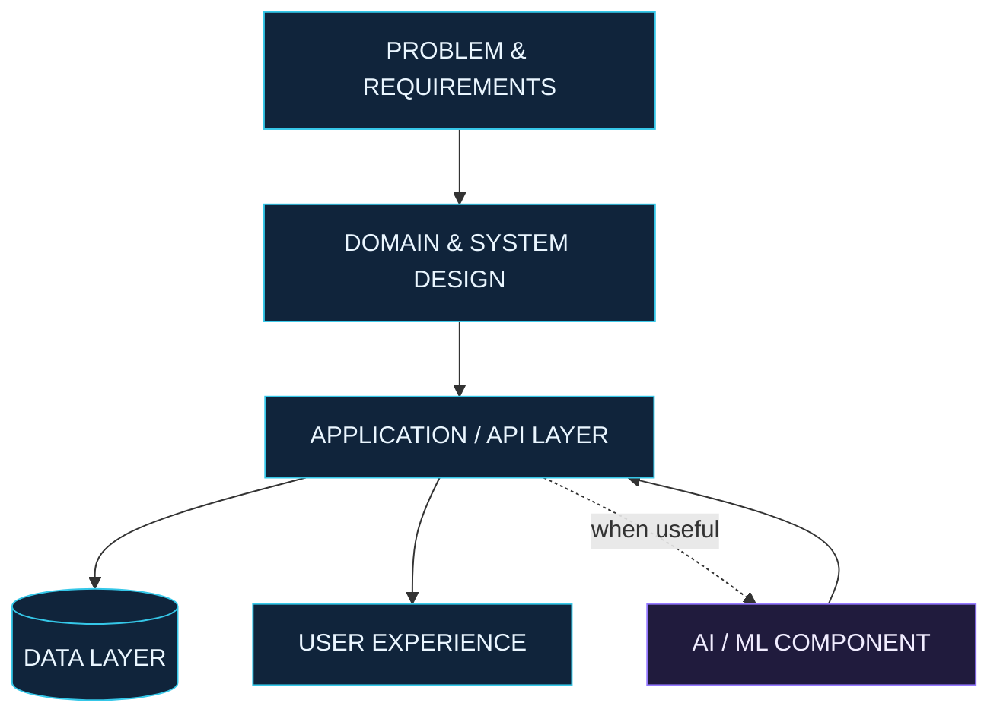

<!--
  NEXUS — a unified engineering-lab profile
  Youssra Hamidouche | Software Engineering × Artificial Intelligence
-->

  

  <a href="https://linkedin.com/in/youssra-hamidouche-213025248">LINKEDIN</a>
  &nbsp; / &nbsp;
  <a href="mailto:youssrahamidouche@gmail.com">EMAIL</a>
  &nbsp; / &nbsp;
  <a href="https://github.com/YouSS3ra?tab=repositories">REPOSITORIES</a>

<h2 align="center">01 / THE ENGINEER</h2>

  I'm Youssra, a Computer Engineering student at ENIAD, Morocco. 
  I enjoy understanding how systems work, turning requirements into maintainable software, 
  and exploring where intelligent methods can create practical value.

  <strong>OPEN TO</strong> 
  6-month Final-Year Internship (PFE) · February / March 2027

---

<h2 align="center">02 / TWO CONNECTED DOMAINS</h2>

  One engineering mindset — from reliable software foundations to data-driven capabilities.

<table>
  <tr>
    <td width="50%" valign="top">
      
<strong>01 — SOFTWARE ENGINEERING</strong>

      
Designing and building dependable applications.

      <ul>
        <li>Backend development and REST APIs</li>
        <li>Object-oriented design and architecture</li>
        <li>Data modelling and persistence</li>
        <li>Full-stack application development</li>
      </ul>
    </td>
    <td width="50%" valign="top">
      
<strong>02 — ARTIFICIAL INTELLIGENCE</strong>

      
Learning how data and models can support useful solutions.

      <ul>
        <li>Machine learning and deep learning</li>
        <li>Data preparation and analysis</li>
        <li>Model development with Python</li>
        <li>Connecting AI capabilities to software</li>
      </ul>
    </td>
  </tr>
</table>

---

<h2 align="center">03 / THE TOOLCHAIN</h2>

Technologies I have worked with across projects, coursework and practice.

<table>
  <tr>
    <td width="25%"><strong>LANGUAGES</strong></td>
    <td>
      
      
      
      
      
      
      
    </td>
  </tr>
  <tr>
    <td><strong>APPLICATIONS</strong></td>
    <td>
      
      
      
      
      
      
      
    </td>
  </tr>
  <tr>
    <td><strong>AI & DATA</strong></td>
    <td>
      
      
      
    </td>
  </tr>
  <tr>
    <td><strong>DATA STORES</strong></td>
    <td>
      
      
      
      
      
    </td>
  </tr>
  <tr>
    <td><strong>WORKFLOW</strong></td>
    <td>
      
      
      
      
    </td>
  </tr>
</table>

---

<h2 align="center">04 / SYSTEMS THINKING</h2>

  I approach an application as a set of connected components: 
  each with a responsibility, a clear interface and an intentional flow of data.

---

<h2 align="center">05 / CURRENT COORDINATES</h2>

<table>
  <tr>
    <td width="50%" valign="top">
      <strong>DEEPENING</strong>  
      Software architecture · Backend engineering · Design principles · Distributed-systems fundamentals · Cloud and containerization
    </td>
    <td width="50%" valign="top">
      <strong>CURIOUS TO EXPLORE</strong>  
      Generative AI · LLM-based applications · AI agents · Retrieval-augmented generation
        
      Learning interests — not claimed as existing expertise.
    </td>
  </tr>
</table>

---

<h2 align="center">06 / LET'S CONNECT</h2>

  Interested in thoughtful engineering, collaborative learning or a PFE opportunity?
    
  <a href="mailto:youssrahamidouche@gmail.com">GET IN TOUCH</a>
  &nbsp; / &nbsp;
  <a href="https://linkedin.com/in/youssra-hamidouche-213025248">LINKEDIN</a>
  &nbsp; / &nbsp;
  <a href="https://github.com/YouSS3ra">GITHUB</a>

  NEXUS / Build with clarity. Explore with curiosity. Engineer with purpose.

