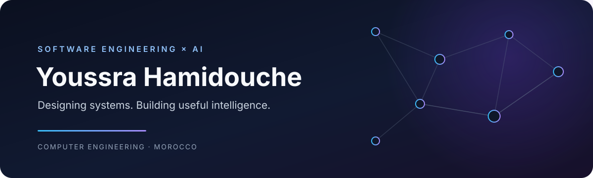

  

  <a href="https://linkedin.com/in/youssra-hamidouche-213025248">LINKEDIN</a>
  &nbsp;&nbsp;·&nbsp;&nbsp;
  <a href="mailto:youssrahamidouche@gmail.com">EMAIL</a>
  &nbsp;&nbsp;·&nbsp;&nbsp;
  <a href="https://github.com/YouSS3ra?tab=repositories">GITHUB</a>

  <em>Curious by nature. Structured in thought. Intentional in what I build.</em>

---

## 01 &nbsp; / &nbsp; A little about me

I'm a **Computer Engineering student at ENIAD, Morocco**, drawn to the space where thoughtful software design meets intelligent problem-solving.

I enjoy going beyond making things work: understanding the problem, reasoning about the structure, and building solutions that are clear, useful and maintainable. My interests span **backend and full-stack engineering, software architecture, and machine learning** — two complementary perspectives that I want to keep developing together.

Currently preparing for a **6-month final-year internship (PFE), starting February/March 2027**.

## 02 &nbsp; / &nbsp; What I work with

LANGUAGES

APPLICATION DEVELOPMENT

AI, DATA & STORAGE

TOOLS & WORKFLOW

## 03 &nbsp; / &nbsp; Selected work

### [Startup LaunchPad](https://github.com/YouSS3ra/Startup-LaunchPad)

An offline-first Flutter application that helps organize startup ideas, manage tasks through a Kanban board and follow a project roadmap.

FLUTTER &nbsp;·&nbsp; DART &nbsp;·&nbsp; SQLITE

## 04 &nbsp; / &nbsp; On my radar

<table>
  <tr>
    <td width="50%" valign="top">
      <strong>DEEPENING</strong>  
      Software architecture 
      Distributed systems 
      Cloud &amp; backend engineering
    </td>
    <td width="50%" valign="top">
      <strong>EXPLORING NEXT</strong>  
      Generative AI 
      LLM-powered applications 
      AI agents &amp; retrieval-augmented generation
    </td>
  </tr>
</table>
Some topics are active learning areas; others are interests I am looking forward to exploring.

## 05 &nbsp; / &nbsp; Get in touch

  <em>Good ideas grow through good conversations.</em>

<table align="center">
  <tr>
    <td align="center" width="33%">
      <a href="mailto:youssrahamidouche@gmail.com"><strong>✉ EMAIL</strong></a> 
      For opportunities &amp; collaboration
    </td>
    <td align="center" width="33%">
      <a href="https://linkedin.com/in/youssra-hamidouche-213025248"><strong>↗ LINKEDIN</strong></a> 
      Let's connect professionally
    </td>
    <td align="center" width="33%">
      <a href="https://github.com/YouSS3ra?tab=repositories"><strong>⌘ GITHUB</strong></a> 
      Explore what I'm building
    </td>
  </tr>
</table>

  OPEN TO PFE OPPORTUNITIES · FEBRUARY / MARCH 2027

