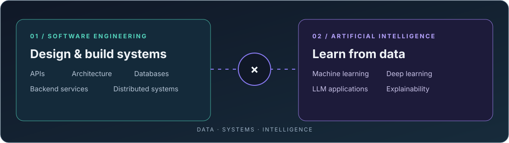
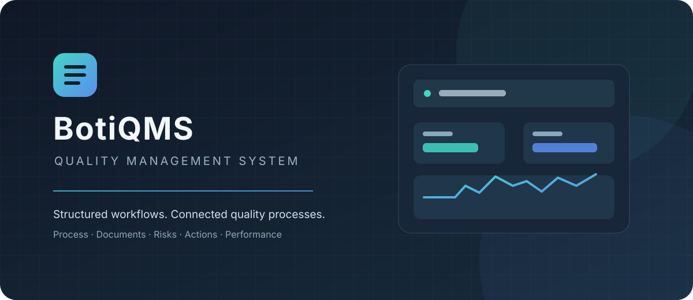

  

<strong>Understand the system. Design with intent. Build with purpose.</strong>

  

  <a href="https://linkedin.com/in/youssra-hamidouche-213025248"><strong>LINKEDIN</strong></a>
  &nbsp;·&nbsp;
  <a href="mailto:youssrahamidouche@gmail.com"><strong>EMAIL</strong></a>
  &nbsp;·&nbsp;
  <a href="https://github.com/YouSS3ra?tab=repositories"><strong>REPOSITORIES</strong></a>

  
  
  

---

## 01 / About

I'm a **final-year Computer Engineering student at ENIAD, Morocco**, interested in designing and building useful, reliable, and maintainable software systems.

My interests sit at the intersection of **Software Engineering and Artificial Intelligence**. I enjoy understanding how systems work, structuring application backends, connecting components, and exploring how data-driven techniques can solve practical problems.

I value clear requirements, deliberate design decisions, and solutions whose behaviour can be understood, tested, and maintained.

  

**Currently seeking a 6-month final-year internship (PFE), starting February/March 2027**, focused on Software Engineering and Artificial Intelligence.

## 02 / Engineering × Intelligence

  

<table>
  <tr>
    <td width="50%" valign="top">
      <h3>Software Engineering</h3>
      STRUCTURE · RELIABILITY · MAINTAINABILITY
      
Turning requirements into well-structured applications through clear abstractions, sound architecture, and deliberate engineering decisions.

    </td>
    <td width="50%" valign="top">
      <h3>Artificial Intelligence</h3>
      DATA · REASONING · PRACTICAL APPLICATIONS
      
Exploring how models and data can extend software capabilities, while keeping usefulness, evaluation, and explainability in view.

    </td>
  </tr>
</table>

---

## 03 / Selected Projects

A selection of academic, personal, and professional work exploring intelligent systems, application engineering, and practical software design.

### KSentinel — Intelligent Fraud Detection & Risk Scoring

  

  
  

**TEAM PROJECT · AI · JAVA · SPRING BOOT · PLATFORM ENGINEERING**

An intelligent fraud-detection and risk-scoring platform designed to analyse transactions, identify suspicious behaviour, and make risk-related insights accessible through analyst-oriented interfaces.

The project brings together complementary detection approaches — supervised learning, anomaly detection, deep learning, and graph learning — within a broader application platform.

**Explore:** [Project overview](https://github.com/YouSS3ra/KSentinel-Showcase) · [Platform architecture](https://github.com/YouSS3ra/KSentinel-Showcase#3-platform-architecture)

Developed collaboratively at ENIAD during the 2025–2026 academic year. Presented here as a shared team project.

### Other Engineering Projects

<table>
  <tr>
    <td width="50%" valign="top">
      
      <h3>REPARTOUT</h3>
      JAVA · SPRING BOOT · SPRING SECURITY
      
A service-management application for customer and equipment records, technical intervention tracking, and rule-based diagnostic assistance.

      <a href="https://github.com/YouSS3ra/Repartout-PWA"><strong>EXPLORE PROJECT ↗</strong></a>
    </td>
    <td width="50%" valign="top">
      
      <h3>ProcessScope</h3>
      PYTHON · WINDOWS · GUI & CLI
      
A Windows process-monitoring application with live CPU and memory tracking, configurable alerts, performance visualisation, CSV reports, and command-line monitoring.

      <a href="https://github.com/YouSS3ra/ProcessScope"><strong>EXPLORE PROJECT ↗</strong></a>
    </td>
  </tr>
  <tr>
    <td width="50%" valign="top">
      
      <h3>BotiQMS</h3>
      FULL-STACK · LARAVEL · VUE.JS · TYPESCRIPT
      
A modular Quality Management System developed during a professional internship, bringing quality processes and business workflows into a structured web application.

      <a href="https://github.com/YouSS3ra/boti-qms-showcase"><strong>PUBLIC SHOWCASE ↗</strong></a>
      
Public overview only; application source and confidential materials remain private.

    </td>
    <td width="50%" valign="top">
      
      <h3>Startup LaunchPad</h3>
      FLUTTER · DART · SQLITE
      
A mobile workspace for capturing ideas, organizing priorities, managing work through a Kanban board, and structuring a product roadmap.

      <a href="https://github.com/YouSS3ra/Startup-LaunchPad"><strong>EXPLORE PROJECT ↗</strong></a>
    </td>
  </tr>
</table>

  <a href="https://github.com/YouSS3ra?tab=repositories"><strong>EXPLORE ALL REPOSITORIES ↗</strong></a>

---

## 04 / Professional Experience

<table>
  <tr>
    <td width="18%" valign="top">
      <strong>JUL — SEP</strong> 
      2026
    </td>
    <td valign="top">
      <strong>Full-Stack Developer Intern</strong> 
      BotiSchool · Morocco
      
Developed BotiQMS, a modular Quality Management System, working across backend application logic, frontend interfaces, data management, and business workflows.

      
Laravel · Vue.js · TypeScript · MySQL

      <a href="https://github.com/YouSS3ra/boti-qms-showcase">Public project overview ↗</a>
    </td>
  </tr>
</table>

The public showcase intentionally excludes private source code, internal infrastructure details, and confidential business information.

## 05 / Technical Toolkit

The technologies below reflect tools used across academic, personal, and professional projects. Experience and depth vary by technology.

| Area | Technologies |
|---|---|
| **Languages** | Java · Python · C# · JavaScript · TypeScript · PHP · SQL |
| **Backend & APIs** | Spring Boot · .NET · Node.js · Express · Laravel · REST APIs · JPA / Hibernate |
| **Frontend** | React · Vue.js · HTML · CSS |
| **AI & Data** | Scikit-learn · TensorFlow · LightGBM · XGBoost · Pandas · NumPy · SHAP |
| **Databases & Messaging** | PostgreSQL · MySQL · MongoDB · Oracle · SQL Server · Redis · Kafka |
| **Engineering Tools** | Git · GitHub · Docker · Postman |

## 06 / What I'm Exploring Now

Beyond the technologies I use, I'm digging into the mechanisms and trade-offs that shape real-world systems and intelligent applications.

<table>
  <tr>
    <td width="50%" valign="top">
      <h3>Systems & Software</h3>
      HOW RELIABLE SYSTEMS WORK UNDER THE HOOD
      <ul>
        <li><strong>Distributed systems:</strong> service communication, consistency, fault tolerance, and horizontal scaling.</li>
        <li><strong>Cloud foundations:</strong> data centres, virtualization, hypervisors, containers, IaaS/PaaS, and deployment.</li>
        <li><strong>Backend internals:</strong> JVM fundamentals, memory, concurrency, and database internals.</li>
        <li><strong>System design:</strong> balancing reliability, performance, cost, and maintainability.</li>
      </ul>
    </td>
    <td width="50%" valign="top">
      <h3>AI Engineering</h3>
      FROM MODEL BEHAVIOUR TO USEFUL APPLICATIONS
      <ul>
        <li><strong>ML foundations:</strong> revisiting machine-learning and deep-learning concepts and model behaviour.</li>
        <li><strong>LLM systems:</strong> RAG pipelines, retrieval quality, context management, and agent workflows.</li>
        <li><strong>Evaluation & explainability:</strong> assessing output quality, reliability, interpretability, and limitations.</li>
        <li><strong>AI integration:</strong> connecting models to backend services and practical software workflows.</li>
      </ul>
    </td>
  </tr>
</table>

## 07 / GitHub Activity

  

## 08 / Let's Build Something Meaningful

  <strong>Interested in engineering, intelligent applications, or building useful products?</strong>

  I'm glad to connect with engineers, teams, and people who enjoy turning thoughtful ideas into practical solutions.

  <strong>Open to a 6-month PFE starting February/March 2027</strong> 
  Software Engineering · Artificial Intelligence

  
  &nbsp;
  

  

BUILD WITH CURIOSITY · ENGINEER WITH INTENTION

