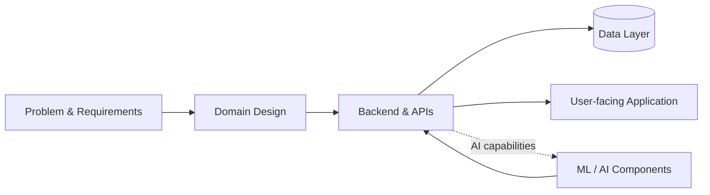

<!--
  Youssra Hamidouche | GitHub profile
  Software Engineering × Artificial Intelligence
-->

  

  <a href="https://linkedin.com/in/youssra-hamidouche-213025248">LinkedIn</a>
  &nbsp;·&nbsp;
  <a href="mailto:youssrahamidouche@gmail.com">Email</a>
  &nbsp;·&nbsp;
  <a href="https://github.com/YouSS3ra?tab=repositories">Repositories</a>

<h2 align="center">Hello, I'm Youssra 👋</h2>

  Computer Engineering student at <strong>ENIAD</strong>, Morocco 
  Interested in building dependable software and making intelligent systems useful.

  <strong>Currently seeking a 6-month PFE internship · February/March 2027</strong>

---

## The intersection I enjoy

<table>
  <tr>
    <td width="50%" valign="top">
      <h3>⚙️ Software Engineering</h3>
      
Turning requirements into structured, maintainable applications.

      <ul>
        <li>Backend development & REST APIs</li>
        <li>Object-oriented design & architecture</li>
        <li>Database modelling & persistence</li>
        <li>Full-stack application development</li>
      </ul>
    </td>
    <td width="50%" valign="top">
      <h3>🧠 Artificial Intelligence</h3>
      
Exploring how data-driven methods can solve practical problems.

      <ul>
        <li>Machine learning & deep learning</li>
        <li>Data analysis and preparation</li>
        <li>Model development with Python</li>
        <li>AI integration into software products</li>
      </ul>
    </td>
  </tr>
</table>

## My engineering toolbox

<strong>Languages</strong> 
  
  
  
  
  
  
  

<strong>Backend & Frontend</strong> 
  
  
  
  
  
  
  

<strong>AI, Data & Persistence</strong> 
  
  
  
  
  
  

<strong>Tools</strong> 
  
  
  

## How I approach systems

I like to reason about software as a set of components with clear responsibilities, explicit interfaces and well-defined data flows.

## Exploring & Looking Ahead

**Currently deepening my understanding of**
- Software architecture, design principles and maintainability
- Scalable backend systems and distributed-systems fundamentals
- Cloud infrastructure and containerized applications

**Areas I'm curious to discover**
- Generative AI and the engineering behind AI-powered applications

---

  <strong>Have an interesting engineering problem or internship opportunity?</strong> 
  <a href="mailto:youssrahamidouche@gmail.com">Let's connect</a>
  &nbsp;·&nbsp;
  <a href="https://linkedin.com/in/youssra-hamidouche-213025248">LinkedIn</a>

  Build with clarity. Learn deeply. Improve continuously.

