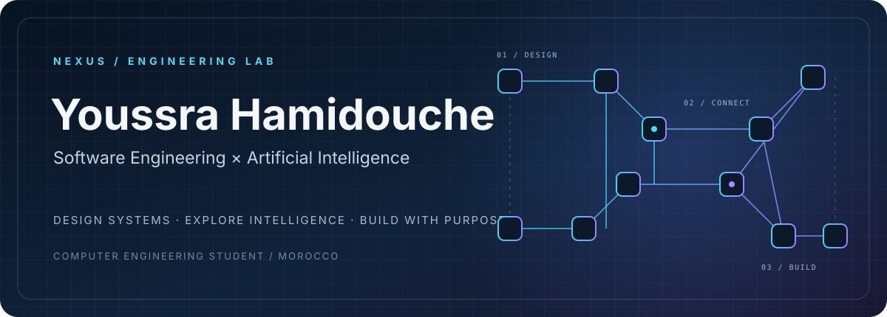
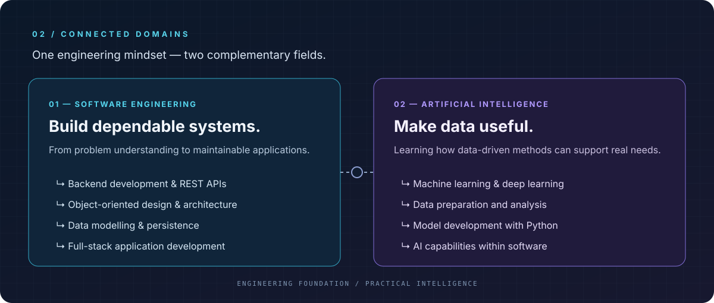
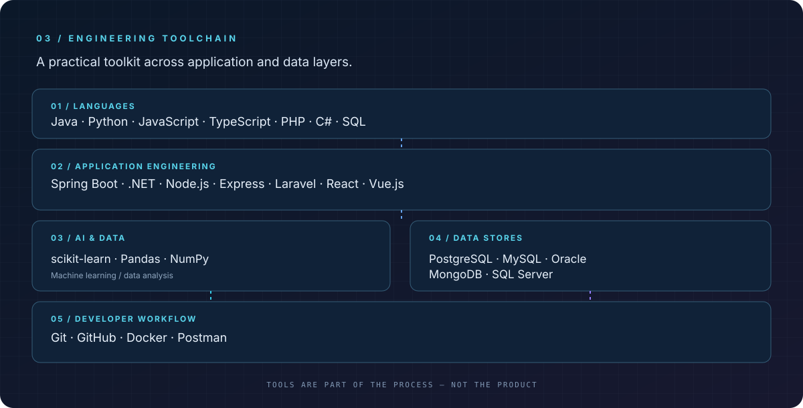
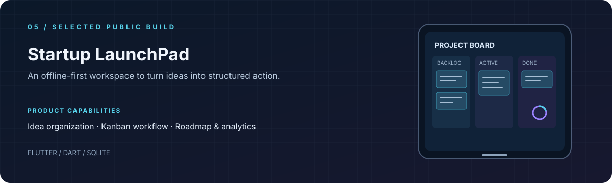
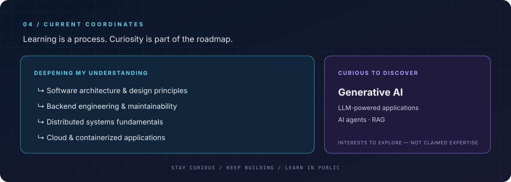

  

  <a href="https://linkedin.com/in/youssra-hamidouche-213025248">LINKEDIN</a>
  &nbsp; · &nbsp;
  <a href="mailto:youssrahamidouche@gmail.com">EMAIL</a>
  &nbsp; · &nbsp;
  <a href="https://github.com/YouSS3ra?tab=repositories">ALL REPOSITORIES</a>

  I'm a Computer Engineering student at ENIAD, Morocco. I enjoy understanding how systems work,
  designing maintainable software and exploring how intelligent methods can solve practical problems.
    
  <strong>AVAILABLE FOR A 6-MONTH PFE · FEBRUARY / MARCH 2027</strong>

  

  

  

  

  <a href="https://github.com/YouSS3ra?tab=repositories">EXPLORE MY REPOSITORIES</a>
  &nbsp; · &nbsp;
  <a href="https://linkedin.com/in/youssra-hamidouche-213025248">CONNECT ON LINKEDIN</a>
  &nbsp; · &nbsp;
  <a href="mailto:youssrahamidouche@gmail.com">GET IN TOUCH</a>

  NEXUS / Build with clarity. Explore with curiosity. Engineer with purpose.

